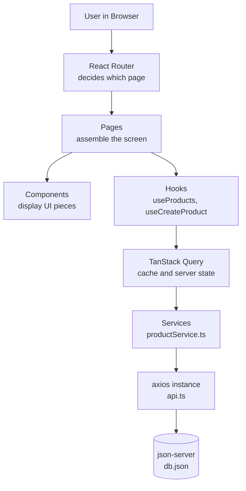
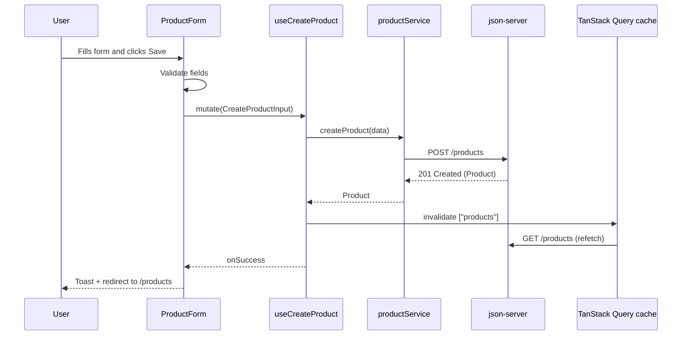

# Project Structure and System Design Notes

**Project:** ShopEase, a TypeScript e-commerce frontend
**Stack:** Vite, React, TypeScript, Tailwind CSS, React Router, fetch, axios, TanStack Query, json-server
**Audience:** Instructor notes. Simple enough to read out to learners.

**Contents:** Part A: Project structure | Part B: System design | Part C: Recap card | Part D: How the prompt was generated (prompting lessons)

---

## Part A: The Complete Project Structure

This is the **final** structure after all parts are finished. Each file is tagged with the part where you create it, so nothing appears before it is needed.

```text
shopease/
├── db.json                          # Part 0: the fake backend (20 products)
├── index.html                       # Part 0: created by Vite
├── package.json                     # Part 0: scripts: dev, server, build
├── vite.config.ts                   # Part 0: React + Tailwind plugins
├── tsconfig.json                    # Part 0: created by Vite
├── tsconfig.app.json                # Part 0: strict mode ON
├── tsconfig.node.json               # Part 0: created by Vite
├── .env                             # Part 7: VITE_API_URL=http://localhost:3001
├── .env.example                     # Part 7: safe template to commit
├── .gitignore
├── public/
│   └── favicon.svg                  # Part 0
└── src/
    ├── main.tsx                     # Part 0: entry point, mounts <App />
    ├── App.tsx                      # Part 1: renders the router
    ├── index.css                    # Part 0: @import "tailwindcss"; theme tokens
    ├── vite-env.d.ts                # Part 7: types for import.meta.env
    │
    ├── app/                         # "Wiring": things that set up the whole app
    │   ├── router.tsx               # Part 1: all routes in one place
    │   └── providers.tsx            # Part 8: QueryClientProvider + Devtools
    │
    ├── layouts/                     # Shared page frames
    │   ├── MainLayout.tsx           # Part 1: Navbar + <Outlet /> + Footer
    │   └── AuthLayout.tsx           # Part 6: split-screen for login/register
    │
    ├── pages/                       # One file per route (a "screen")
    │   ├── HomePage.tsx             # Part 2
    │   ├── ProductsPage.tsx         # Part 3
    │   ├── ProductDetailsPage.tsx   # Part 4
    │   ├── CreateProductPage.tsx    # Part 5
    │   ├── LoginPage.tsx            # Part 6 (learner assignment)
    │   ├── RegisterPage.tsx         # Part 6 (learner assignment)
    │   └── NotFoundPage.tsx         # Part 1
    │
    ├── components/                  # Reusable building blocks
    │   ├── layout/
    │   │   ├── Navbar.tsx           # Part 1
    │   │   ├── MobileMenu.tsx       # Part 1
    │   │   └── Footer.tsx           # Part 1
    │   ├── home/
    │   │   ├── Hero.tsx             # Part 2
    │   │   ├── FeaturesStrip.tsx    # Part 2
    │   │   ├── FeaturedProducts.tsx # Part 2 (static) then Part 3 (real data)
    │   │   └── Newsletter.tsx       # Part 2
    │   ├── products/
    │   │   ├── ProductCard.tsx      # Part 3
    │   │   ├── ProductGrid.tsx      # Part 3
    │   │   ├── ProductSkeleton.tsx  # Part 3: loading placeholder
    │   │   ├── ProductFilters.tsx   # Part 3: search + category
    │   │   └── ProductForm.tsx      # Part 5
    │   └── ui/                      # Tiny, generic, design-system pieces
    │       ├── Button.tsx           # Part 1
    │       ├── Input.tsx            # Part 5
    │       ├── Select.tsx           # Part 5
    │       ├── Textarea.tsx         # Part 5
    │       ├── Badge.tsx            # Part 3
    │       ├── Spinner.tsx          # Part 3
    │       ├── ErrorMessage.tsx     # Part 3
    │       ├── EmptyState.tsx       # Part 3
    │       └── Toast.tsx            # Part 5
    │
    ├── services/                    # The ONLY place that talks to the API
    │   ├── api.ts                   # Part 7: axios instance (baseURL, headers)
    │   └── productService.ts        # Part 7: getProducts, getProductById, createProduct
    │
    ├── hooks/                       # Reusable logic
    │   ├── useDebounce.ts           # Part 3: delays search typing
    │   ├── useProducts.ts           # Part 8: useQuery wrapper
    │   ├── useProduct.ts            # Part 8: useQuery by id
    │   └── useCreateProduct.ts      # Part 8: useMutation wrapper
    │
    ├── types/                       # Shared TypeScript contracts
    │   └── product.ts               # Part 0/3: Product, CreateProductInput, Category
    │
    └── lib/                         # Small helpers and constants
        ├── constants.ts             # Part 1: nav links, categories list
        ├── queryKeys.ts             # Part 8: ["products"], ["products", id]
        └── utils.ts                 # Part 3: formatPrice(), cn()
```

### What each folder is for (one line each)

| Folder           | Job                                              | Easy analogy                     |
| ---------------- | ------------------------------------------------ | -------------------------------- |
| `app/`           | Starts and wires the app together                | The electricity board of a house |
| `layouts/`       | The frame that stays the same while pages change | A picture frame                  |
| `pages/`         | One screen per URL                               | Rooms in a house                 |
| `components/`    | Reusable UI pieces                               | Lego bricks                      |
| `components/ui/` | The smallest bricks (button, input)              | Screws and nails                 |
| `services/`      | Talks to the server, nothing else                | The postman                      |
| `hooks/`         | Reusable logic (not UI)                          | Handy tools in a toolbox         |
| `types/`         | Shapes of our data                               | Blueprints                       |
| `lib/`           | Tiny helpers and constants                       | A drawer of small tools          |

### The golden rules of this structure

1. **Pages assemble, components display.** A page decides *what* to show. A component knows *how* to show one thing.
2. **Only `services/` talks to the API.** If the backend URL changes, you change one file.
3. **Types live in `types/`.** One definition, used everywhere.
4. **Components never fetch on their own** (after Part 8, they call hooks, and hooks call services).
5. **A file does one job.** If you cannot describe it in one sentence, split it.

### Core types (the heart of the TypeScript lesson)

```ts
// src/types/product.ts
export type Category = "Electronics" | "Fashion" | "Home" | "Beauty";

export interface Product {
  id: number;
  name: string;
  price: number;
  category: Category;
  image: string;
  description: string;
  rating: number; // 1 to 5
  stock: number;
}

// When creating a product the server makes the id, so we leave it out.
export type CreateProductInput = Omit<Product, "id">;
```

### Route table

| URL             | Page               | Layout     | Added in |
| --------------- | ------------------ | ---------- | -------- |
| `/`             | HomePage           | MainLayout | Part 2   |
| `/products`     | ProductsPage       | MainLayout | Part 3   |
| `/products/:id` | ProductDetailsPage | MainLayout | Part 4   |
| `/products/new` | CreateProductPage  | MainLayout | Part 5   |
| `/login`        | LoginPage          | AuthLayout | Part 6   |
| `/register`     | RegisterPage       | AuthLayout | Part 6   |
| `*`             | NotFoundPage       | MainLayout | Part 1   |

> Tip for learners: put `/products/new` **before** `/products/:id` in thinking, because "new" could be mistaken for an id. React Router ranks static paths above dynamic ones, but it is a great moment to explain route matching.

---

## Part B: System Design, Explained Simply

### 1. What is system design?

***MAIN: System design is the process of planning the architecture, components, modules, interfaces, and data flow of a software system before writing code. It acts as a blueprint to ensure the application remains scalable, reliable, and efficient as user traffic and data grow***

**System design is deciding how the pieces of an app fit together before (and while) you build it.**


Think of building a house. You do not start by stacking bricks. You first decide where the kitchen goes, where the pipes run, and where the front door is. System design is that plan for software.

It answers four simple questions:

1. **What are the pieces?** (pages, components, services, a server)
2. **What does each piece do?** (its single job)
3. **How do the pieces talk to each other?** (data flow)
4. **What happens when something goes wrong or grows?** (errors, loading, scale)

> Good to know: system design is not only for giant companies. Even a small frontend has a "system": screens, data, rules, and flow.

### 2. Why is it important?

| Without a plan                       | With a plan                             |
| ------------------------------------ | --------------------------------------- |
| Fetch calls copy-pasted in 10 files  | One service file, change once           |
| Fixing one bug breaks another page   | Pieces are separate, changes stay local |
| New teammate is lost                 | Folder names tell the story             |
| App slows down when data grows       | Caching and pagination were planned     |
| Loading and error handling forgotten | Every data screen has all three states  |
| Hard to test or reuse                | Small pieces are easy to reuse and test |

In short: **system design saves time later, reduces bugs, and makes the app easy to grow.** For learners building with AI, it is even more important. AI writes code fast, but *you* must decide where the code lives. A learner with a clear structure can ask AI for the right thing and put it in the right place.

### 3. The big picture of ShopEase



Read it from top to bottom: the user clicks, the router picks a page, the page uses hooks to get data, the hooks use a smart cache, the cache asks a service, the service asks the server.

### 4. The layers (and the one rule that connects them)

| Layer        | Folders                             | Responsibility            |
| ------------ | ----------------------------------- | ------------------------- |
| Presentation | `components/`, `pages/`, `layouts/` | What the user sees        |
| Logic        | `hooks/`                            | When and how data is used |
| Data access  | `services/`                         | How we talk to the API    |
| Contract     | `types/`                            | What the data looks like  |
| Foundation   | `app/`, `lib/`                      | Setup and helpers         |

**The one rule: dependencies point downward.** A page can use a component. A component can use a hook. A hook can use a service. But a service must never import a page. This keeps the system tidy and prevents tangled code.

### 5. State: the four kinds of data in the app

Many beginners put everything in `useState`. System design teaches us to ask: *where does this data really belong?*

| Kind of state                                             | Example in ShopEase             | Best tool           |
| --------------------------------------------------------- | ------------------------------- | ------------------- |
| **Server state** (lives on the server, we only borrow it) | The 20 products                 | TanStack Query      |
| **UI state** (only the screen cares)                      | Is the mobile menu open?        | `useState`          |
| **URL state** (should survive refresh and sharing)        | `/products/7`, `?category=Home` | React Router        |
| **Form state** (typing in progress)                       | Create-product form fields      | `useState` (simple) |

**Why Part 8 matters:** server state is special. It can become *stale*, it must be *cached*, and many components may need the *same* data. Doing that by hand with `useEffect` is painful, which is why we first feel the pain (Parts 3 to 5) and then upgrade (Part 8). Learners remember lessons better when they feel the problem first.

### 6. The API contract

Frontend and backend agree on a contract. Our json-server gives us:

| Action         | Method and URL      | Body                 | Returns                   |
| -------------- | ------------------- | -------------------- | ------------------------- |
| List products  | `GET /products`     | none                 | `Product[]`               |
| One product    | `GET /products/:id` | none                 | `Product`                 |
| Create product | `POST /products`    | `CreateProductInput` | `Product` (with new `id`) |

TypeScript enforces the contract on the frontend. If someone renames `price` to `cost`, the compiler shows red lines everywhere it matters, before users ever see a bug.

### 7. Data flow: what happens when a user creates a product



**Why this design is good:** the form never knows about URLs or axios. The service never knows about React. The cache keeps the list fresh automatically. Each piece has one job.

### 8. The three states every data screen needs

Every screen that loads data must handle:

1. **Loading:** show skeleton cards (never a blank screen)
2. **Error:** friendly message plus a Retry button
3. **Empty:** "No products found" with a helpful action

Plus the fourth, the happy path: show the data. We build `ProductSkeleton`, `ErrorMessage`, and `EmptyState` once in `components/ui/` and reuse them on every page. That is system design in action: **solve a problem once, reuse everywhere.**

### 9. Design decisions and the reasons behind them

| Decision                                     | Why we chose it                                 | Trade-off                                   |
| -------------------------------------------- | ----------------------------------------------- | ------------------------------------------- |
| Vite instead of CRA/Next                     | Fast, simple, no server complexity              | No built-in server rendering                |
| TypeScript strict mode                       | Catches mistakes early, self-documenting code   | Slightly more typing                        |
| `json-server`                                | Free, zero setup, supports GET and POST         | Not secure, not for production              |
| Separate `services/` layer                   | Swap fetch/axios/backend in one place           | One extra file                              |
| fetch first, then axios, then TanStack Query | Learners feel each upgrade's value              | Some code is rewritten on purpose           |
| Folder by type (`components`, `pages`)       | Easy for beginners to find things               | For huge apps, feature folders scale better |
| `.env` for the API URL                       | No hard-coded URLs, easy to switch environments | Needs the `VITE_` prefix                    |
| Reusable `ui/` components                    | Consistent polished look                        | Takes effort up front                       |

### 10. How the design evolves across the course

| Part | System design idea learners meet                  |
| ---- | ------------------------------------------------- |
| 0    | Fake backend and the API contract                 |
| 1    | Layout, routing, separation of concerns           |
| 2    | Component composition                             |
| 3    | Data fetching, loading, error, empty states       |
| 4    | URL state with dynamic routes                     |
| 5    | Forms, validation, writing data (POST)            |
| 6    | Reusing the design system (assignment)            |
| 7    | Service layer, environment config, axios instance |
| 8    | Server state, caching, invalidation               |
| 9    | Review: consistency, accessibility, performance   |

### 11. How this could scale (talking points, not code)

- **Real backend:** replace json-server with Node/Express, Django, etc. Only `services/api.ts` and `.env` change.
- **Authentication:** add a token to the axios instance with an interceptor.
- **Pagination or infinite scroll:** `useInfiniteQuery` and `?_page=` params.
- **Cart:** React Context or Zustand (client state).
- **Performance:** lazy-load routes with `React.lazy`, optimize images, debounce search.
- **Testing:** services and hooks are easy to test because they are separate.
- **Folders:** at larger scale, move to feature folders (`features/products/...`).

### 12. Quick teaching script (2 minutes, say it aloud)

> "Before we write code, we draw the map. Our app has screens, small UI pieces, a messenger that talks to the server, and a smart memory that remembers what the server said. Each has one job and talks only to its neighbor. If something breaks, we know exactly which room to open. That map is called system design, and it is the difference between code that works today and code that is still easy to change next month."

---

## Part C: Learner-Friendly Recap Card

- **System design = the plan for how pieces fit together.**
- **Pages assemble. Components display. Hooks think. Services talk to the server. Types describe the data.**
- **Server data is special, so we use TanStack Query for it.**
- **Every screen handles loading, error, empty, and success.**
- **Change one thing in one place, not ten.**

---

## Part D: How This Prompt Was Generated (and How You Can Prompt the Same Way)

> **Goal of this part:** students should not only *use* the master prompt. They should understand *why it was written this way*, so they can write strong prompts for their own projects.

### 1. The big idea

**A prompt is a brief you give to a very capable but very literal assistant.**

Imagine hiring a brilliant new teammate who has never met you. They know almost everything about coding, but they know nothing about *your* learners, *your* stack, or *your* rules. If you say "teach them React", you will get a generic answer. If you give a clear brief, you get exactly what you need.

> Simple rule: **the AI can only follow what you tell it. Missing details get filled with guesses.**

### 2. Where we started: the raw request

The first request was a plain-language wish list. It said, in effect:

- Teach fullstack learners to build a project, recommend one, and let me choose
- Stack: React, Tailwind CSS, fetch/axios, then TanStack Query
- Start with fetch, upgrade to TanStack Query later
- Explain every step in simple terms
- Polished UI, mobile responsive
- Every response must be a downloadable markdown file
- Pages: landing (header, hero, products, footer), product details, login and register as an assignment, create-product form, products list from a JSON file with 20 products
- Step by step, with detailed prompts for each page

A wish list is not yet a good prompt. It mixes goals, rules, and content. The work of "prompt engineering" is sorting those into clear boxes.

### 3. The method: 8 steps from wish list to master prompt

| Step                               | Question we asked                    | What we did in this project                                                                               |
| ---------------------------------- | ------------------------------------ | --------------------------------------------------------------------------------------------------------- |
| 1. Define the outcome              | What should exist when this works?   | A teaching assistant that guides learners through a full project, one step at a time                      |
| 2. Know the audience               | Who will read the output?            | Learners who know basic web skills; later updated to "already know TypeScript"                            |
| 3. Fix the constraints             | What must never change?              | Stack locked (Vite, React, TypeScript, Tailwind, React Router, fetch, axios, TanStack Query, json-server) |
| 4. Choose the output format        | In what shape should answers arrive? | One downloadable markdown file per response, with a fixed template                                        |
| 5. Break the work into a sequence  | What is the best order to learn?     | Parts 0 to 9, one step per response                                                                       |
| 6. Give a template for each answer | How should every step look?          | A 10-section step template (concept, files, AI prompt, code, checkpoint, challenge)                       |
| 7. Add guardrails and behavior     | What must the AI always or never do? | "Never skip a step", "STOP and wait", "no `any`", "explain simply"                                        |
| 8. Test and improve                | Did it work? What is missing?        | Version 2 added TypeScript, project structure, and system design                                          |

### 4. How each original requirement landed in the prompt

| Your requirement                               | Where it lives in the master prompt                                       | Technique used                         |
| ---------------------------------------------- | ------------------------------------------------------------------------- | -------------------------------------- |
| "Recommend a project and let me choose"        | **STEP 0: PROJECT SELECTION** with a menu of 5 and a STOP-and-wait rule   | Human-in-the-loop gate                 |
| "React, Tailwind, fetch/axios, TanStack Query" | **TECH STACK** section                                                    | Fixed constraints                      |
| "Fetch first, then upgrade to TanStack Query"  | **ROADMAP**: Parts 3 to 6 use fetch, Part 7 axios, Part 8 TanStack Query  | Sequencing the learning path           |
| "Explain in simple terms"                      | **SIMPLICITY RULES** and "Concept in simple terms" in the template        | Style instruction plus a template slot |
| "Polished UI"                                  | **QUALITY RULES FOR ALL UI**                                              | Checklist of measurable standards      |
| "Responses in a downloadable markdown file"    | **OUTPUT RULE (HIGHEST PRIORITY)**                                        | Strict output format plus fallback     |
| "Landing page, details page, forms"            | **ROADMAP** Parts 1 to 5                                                  | Task breakdown                         |
| "Login and register as an assignment"          | **Part 6: LEARNER ASSIGNMENT** (no full code)                             | Conditional behavior                   |
| "20 products in JSON"                          | **DATA RULES for db.json**                                                | Precise data specification             |
| "Detailed prompts for each page"               | Template section 5: **The AI Prompt to paste**                            | Prompts that teach prompting           |
| "They know TypeScript" (v2)                    | **TYPESCRIPT RULES**                                                      | Updating the audience profile          |
| "Project structure and system design" (v2)     | **PROJECT STRUCTURE**, Part 0 Step 1, and "Where this fits in the system" | Context injection                      |

### 5. The anatomy of the master prompt

Every good prompt can be split into labeled blocks. Ours has these:

| Block in the prompt    | What it does                                    | Why it matters                                         |
| ---------------------- | ----------------------------------------------- | ------------------------------------------------------ |
| **ROLE**               | Tells the AI who it is (friendly senior mentor) | Sets tone, depth, and teaching style                   |
| **STUDENT PROFILE**    | Describes the audience                          | The AI adjusts difficulty and vocabulary               |
| **OUTPUT RULE**        | Locks the answer format                         | Guarantees every reply is a downloadable markdown file |
| **TECH STACK**         | Lists allowed tools                             | Stops the AI from swapping libraries                   |
| **TYPESCRIPT RULES**   | Sets code standards                             | Consistent, type-safe code                             |
| **PROJECT STRUCTURE**  | Shows the folder tree                           | The AI always puts files in the right place            |
| **STEP 0 selection**   | Asks the user to choose, then waits             | Makes the experience interactive                       |
| **STEP FILE TEMPLATE** | Fixes the shape of each lesson                  | Every step feels familiar and complete                 |
| **QUALITY RULES**      | Defines "polished"                              | Turns a vague word into a checklist                    |
| **SIMPLICITY RULES**   | Limits complexity                               | Keeps learners from getting lost                       |
| **ROADMAP**            | Ordered steps                                   | The AI follows a path instead of improvising           |
| **DATA RULES**         | Describes the sample data exactly               | Same 20-product shape every time                       |
| **TEACHING BEHAVIOR**  | Rules for debugging, pacing, recaps             | Makes it feel like a real mentor                       |
| **START NOW**          | Tells the AI what to do first                   | Prevents a long, unfocused first reply                 |

### 6. Prompt techniques we used (with plain names)

| Technique                        | What it means                             | Example from our prompt                                         |
| -------------------------------- | ----------------------------------------- | --------------------------------------------------------------- |
| **Role prompting**               | Give the AI a job title                   | "You are a friendly senior frontend mentor"                     |
| **Audience framing**             | Say who the answer is for                 | "Already knows TypeScript basics"                               |
| **Constraints**                  | Draw clear borders                        | "No `any`", "do not swap the stack"                             |
| **Structured output**            | Demand a specific shape                   | The 10-section step template                                    |
| **Chunking**                     | Split a big task into small steps         | "One step per response"                                         |
| **Human-in-the-loop gate**       | Make the AI wait for you                  | "STOP and wait", "Type Next"                                    |
| **Negative instructions**        | Say what *not* to do                      | "Never skip a step, never merge steps"                          |
| **Repetition of critical rules** | Repeat the most important rule            | Output rule at the top, in the template, and in behavior        |
| **Fallback plan**                | Say what to do if something is impossible | "If your tool cannot create files, use one markdown code block" |
| **Examples inside the prompt**   | Show the shape you want                   | The `Product` type and file naming examples                     |
| **Measurable quality**           | Replace vague words with checks           | "Polished" becomes spacing scale, focus rings, loading states   |

### 7. The iteration story: v1 to v2

Great prompts are rarely perfect on the first try. We improved ours by listening to what was missing.

| Version            | Trigger                                                                                                        | Changes                                                                                                                                                                                                                                                     |
| ------------------ | -------------------------------------------------------------------------------------------------------------- | ----------------------------------------------------------------------------------------------------------------------------------------------------------------------------------------------------------------------------------------------------------- |
| **v1**             | The wish list                                                                                                  | JavaScript version: stack, roadmap, step template, markdown output, project menu                                                                                                                                                                            |
| **v2**             | "They already know TypeScript, give the full project structure, explain system design, always return markdown" | Switched to TypeScript with strict rules, added the full folder structure, added a System Design lesson (Part 0, Step 1), added "Where this fits in the system" to every step, upgraded the markdown rule to apply to **every** response with no exceptions |
| **v3 (your turn)** | What will *you* notice when you run it?                                                                        | Add your own rules: testing, a dark mode part, a different project                                                                                                                                                                                          |

> **Lesson for students:** do not aim for the perfect prompt in one go. Write a first version, run it, notice what is wrong, then add one rule that fixes it. Each rule in the master prompt exists because of a real need.

### 8. Before and after: vague vs. optimized

**Vague prompt (what beginners often write):**

```text
Teach me how to build an ecommerce website with React.
```

What goes wrong: unknown level, unknown tools, huge unstructured answer, no polish standard, no order, no checkpoints, code pasted in the chat and lost.

**Optimized prompt (our approach, shortened):**

```text
ROLE: You are a friendly senior frontend mentor.
AUDIENCE: Learners who know TypeScript but are new to React.
GOAL: Guide me to build an e-commerce storefront, one step at a time.
STACK: Vite, React, TypeScript (strict), Tailwind, React Router,
       fetch -> axios -> TanStack Query.
RULES: Explain simply. No `any`. One step per reply. Wait for me to say "Next".
FORMAT: Reply as a downloadable markdown file using this template:
        goal, concept, files, AI prompt, code, how it works, checkpoint.
STEPS: Setup -> Layout -> Landing -> Products list -> Details -> Form -> Upgrade.
START: Show me a project menu and wait for my choice.
```

Why it works: every missing detail from the vague version is now answered.

### 9. The reusable formula: the 6-part prompt

Students can memorize this and use it for any project:

```text
1. ROLE        Who should the AI be?
2. GOAL        What exactly do I want built or explained?
3. CONTEXT     Who am I, what do I already know, what is the project?
4. CONSTRAINTS What tools, rules, and limits must it follow? What must it avoid?
5. FORMAT      What shape should the answer take (file, sections, code blocks)?
6. STEPS       What order should it work in, and when should it wait for me?
```

Memory trick: **R-G-C-C-F-S** → "**R**eally **G**ood **C**ommands **C**reate **F**antastic **S**oftware." 

### 10. How learners prompt the AI during the build (the "AI Prompt to paste")

Inside every lesson step there is a ready-made prompt for building a page or component. These follow a **component prompt formula**:

```text
GOAL         What am I building and in which file?
STACK        React + TypeScript (strict) + Tailwind
TYPES        Which types or props to use (name them)
LAYOUT       Structure and visual design (spacing, colors, shadows, hover)
RESPONSIVE   How it behaves on mobile, tablet, desktop
STATES       Loading, error, empty, success
ACCESSIBILITY Labels, alt text, focus rings, semantic HTML
OUTPUT       "Return full working code, no placeholders, no `any`"
```

**Worked example: the Navbar prompt a learner might paste**

```text
Build src/components/layout/Navbar.tsx for a React + TypeScript (strict)
e-commerce app styled with Tailwind CSS.

Requirements:
- Sticky top bar, white background, subtle bottom border and shadow.
- Left: logo text "ShopEase" in the primary color (indigo-600).
- Center (desktop only): links Home, Products, Add Product using
  NavLink from react-router, active link highlighted.
- Right: cart icon (lucide-react ShoppingCart) with a small count badge,
  and a "Login" button.
- On screens below md: hide the links and show a hamburger button that
  toggles a MobileMenu component (src/components/layout/MobileMenu.tsx).
- Typed props: NavbarProps { cartCount: number }.
- Menu open state: useState<boolean>.
- Smooth transitions, visible focus rings, aria-label on icon buttons,
  aria-expanded on the hamburger.
- Links come from a typed NAV_LINKS array in src/lib/constants.ts.

Return full working code for both files, no placeholders, no `any`.
```

Notice how every line removes a guess. The AI does not have to decide the color, the breakpoint, the file path, or the types, because the prompt already did.

### 11. How to ask for help when something breaks (debug prompt)

```text
I am building [what] with React + TypeScript + Tailwind.
Goal: [what should happen]
Problem: [what happens instead]
Error message (copy exactly): [paste it]
Code: [paste only the relevant file]
What I already tried: [list]
Please explain the cause in simple terms, then give the fix.
```

**Why each line matters:** the exact error message is the single most useful clue. Pasting a screenshot description like "it doesn't work" gives the AI nothing to work with.

### 12. Common prompting mistakes (and fixes)

| Mistake                                  | Why it hurts                          | Fix                                              |
| ---------------------------------------- | ------------------------------------- | ------------------------------------------------ |
| "Build me a website"                     | Too vague, the AI guesses everything  | Use the 6-part formula                           |
| Asking for the whole project at once     | Huge, error-prone, hard to understand | Ask for one step or one component                |
| Not naming the stack                     | The AI picks random libraries         | Always list the stack                            |
| Forgetting types                         | Code with `any` or missing interfaces | Name the types in the prompt                     |
| Using words like "nice" or "modern" only | Not measurable                        | Say: rounded-xl, shadow-sm, hover:-translate-y-1 |
| Never saying the output format           | Messy, unusable answers               | State the format (file, sections, code blocks)   |
| Copying code you do not understand       | You cannot debug it                   | Add: "Explain each part in simple terms"         |
| Not testing                              | Bugs pile up                          | Add a checkpoint after every step                |
| Changing five things at once             | You cannot tell what broke            | Change one thing, run, then continue             |

### 13. Student checklist: before you press Enter

- [ ] Did I say who the AI should be (role)?
- [ ] Did I state exactly what I want (goal)?
- [ ] Did I share my level and project context?
- [ ] Did I list the stack and the rules (including "no `any`")?
- [ ] Did I name the file paths and types?
- [ ] Did I describe states (loading, error, empty)?
- [ ] Did I say the answer format?
- [ ] Is this one small step, not the whole app?
- [ ] Did I ask for a simple explanation?

### 14. Practice exercises for students

1. **Rewrite a vague prompt.** Take "Make a login page" and rewrite it with the 6-part formula and the component prompt formula.
2. **Add a rule.** Run the master prompt, spot one thing you dislike (for example, too long), and add one rule to fix it. Write down what changed.
3. **Swap the project.** Change the project to a Recipe Book. Which parts of the master prompt change? Which stay the same? (Hint: the structure, rules, and roadmap stay; names and data change.)
4. **Debug like a pro.** Break the code on purpose (wrong import path). Write a debug prompt using the template and compare the AI's answer with "it doesn't work".
5. **Write your own master prompt.** Pick a project you love and create a master prompt with the 6 parts, a step template, and one STOP-and-wait rule.

### 15. Instructor demo script (5 minutes)

1. Show the vague prompt and its messy answer.
2. Show the 6-part prompt and its clean answer.
3. Open the master prompt and point at each block: Role, Output rule, Stack, Template, Roadmap.
4. Show the v1 to v2 table and say: "We improved it by noticing gaps, not by guessing."
5. Have learners rewrite one vague prompt using the checklist.

### 16. Recap card for Part D

- **A prompt is a brief. Missing details become guesses.**
- **Use 6 parts: Role, Goal, Context, Constraints, Format, Steps.**
- **Turn vague words into measurable rules.**
- **Ask for one step at a time and make the AI wait for you.**
- **Name your stack, types, files, and states in every component prompt.**
- **Improve prompts by versions: run, notice, add one rule.**
- **When stuck, paste the exact error plus the relevant code.**